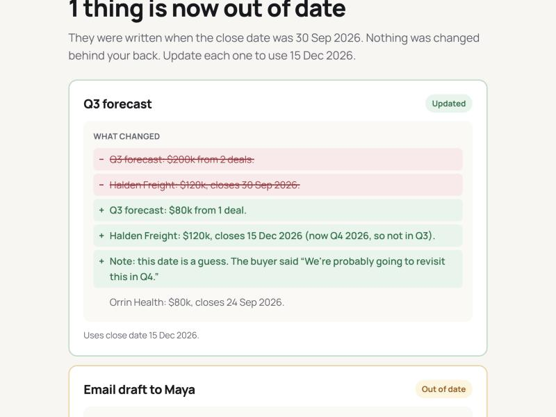

# Threadline

**When a reviewed CRM field changes, which AI-written outputs still rely on the old value?**

Threadline records which fields every generated output read, and at which revision. When a person approves a change, only the outputs that read that field go stale. Each one regenerates with a before/after diff, and unrelated work stays current.

> Independent prototype with fictional data. The scenario follows the close-date example in Kevin Bluett's public guide [“Can you trust a CRM record the AI wrote?”](https://ahoy.ai/guides/trust-ai-written-crm-records/). It is not affiliated with Ahoy.



## The scenario

1. **A hedged change.** On a call the buyer says *“We're probably going to revisit this in Q4.”* An agent proposes moving the Halden Freight close date from 30 Sep to 15 Dec. The proposal keeps the quote and notes that the date is the agent's reading, not something the buyer said.
2. **What relied on it.** Before approval, the Q3 forecast and a drafted follow-up email are shown as *at risk*. After approval they are *stale*, each showing the value it actually read. The Orrin Health account brief never read the field, so it stays current.
3. **Regenerate.** Each stale output is rebuilt from accepted state with a diff. For example, the forecast's Q3 commit drops from $200k across 2 deals to $80k across 1, and the hedge travels with the value.
4. **The reversal.** Two weeks later an email says *“Can we pick this back up for October?”* The second move is reviewed the same way. It doesn't overwrite the first: the field's history shows both moves, and the regenerated forecast says the close date has moved twice.

## What the prototype guarantees

Each guarantee is covered by tests in [`tests/core.test.js`](tests/core.test.js) and [`tests/store.test.js`](tests/store.test.js), and the walkthrough was also checked by hand in a browser.

- **Pending values never reach accepted state or any output text.** An output that reads a field with a pending change is flagged *at risk*; its text is unchanged.
- **Invalidation is selective.** An output goes stale only if a committed revision changes a field it recorded reading.
- **Outputs change only through an explicit rebuild,** and the previous version is kept for the diff.
- **A rebuild uses the output's own generator policy,** so a rebuild can't quietly change what the output depends on.
- **A reversal never erases the earlier move or its hedge.**
- **Every approval and rejection appears in history** at the revision it applied to.
- **Approval is compare-and-set** on the base revision: a proposal made against an older revision is refused.
- **Ingestion is idempotent** by external id: the same email can't create a second proposal.
- **Saved progress survives reload, leaving and returning, and new tabs.** Every save carries a fresh version, and a tab writes only if storage still holds the version it last saw, so a tab that missed another tab's save is refused instead of overwriting it. Empty or corrupt storage is repaired, never adopted. Storage read and write failures are shown, never mistaken for another tab or silently dropped.

## How it works

- [`core.js`](core.js) is a deterministic, append-only event log: proposals, reviews, committed revisions, invalidations and rebuilds. Accepted state, output status and history are all derived from it.
- Each output stores `used`: the field, revision and value it read. Approval marks stale exactly the outputs whose `used` includes the changed field.
- Outputs are generated by deterministic templates (`renderOutput`). There is no LLM. A test checks that the seed outputs equal their templates.
- Rebuilding goes through one context compiler that includes required fields first and fails closed if they don't fit the budget. The receipt records what the output was given.
- [`store.js`](store.js) saves the log to `localStorage` with a version token, doing the check and the write inside a cross-tab lock (`navigator.locks`) where the browser supports it. Tabs re-check on storage events and when they become visible again.
- [`app.js`](app.js) renders the guided walkthrough.

## What it does not do

- **Browser only:** no server, database, shared state or auth. Persistence is one browser's `localStorage`.
- **No LLM or real CRM:** the agents, calls and emails are fixtures, and outputs come from templates.
- **Reads are recorded only for outputs built through the compiler.** Nothing discovers dependencies elsewhere.
- **The receipt hash is a 32-bit FNV-1a of the receipt body.** It is a deterministic fingerprint, not a signature.
- **Clicks in two tabs at the same instant can still race.** The tests prove the version check. `navigator.locks` narrows the window where browsers provide it, but it doesn't order localStorage caches across processes, and it is absent in insecure contexts.

[`ARCHITECTURE.md`](ARCHITECTURE.md) describes how this could become a production service.

## Run locally

```bash
npm run serve
```

Then open `http://localhost:4173`.

Run the tests (Node 20 or newer; there are no dependencies):

```bash
npm test
```
